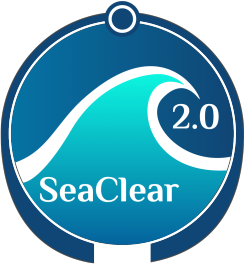
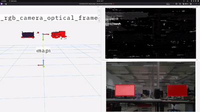
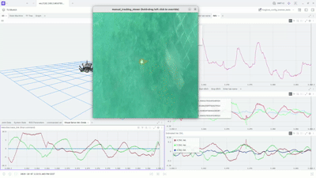

<p align="center">
  
</p>

# 🌊 oakd_isaac_ros

**Contents:** [📖 Introduction](#-introduction) · [🧰 Requirements](#-requirements) · [🚀 Quickstart](#-quickstart) · [🎬 Demos](#-demos) · [🔧 Troubleshooting](#-troubleshooting) · [📚 Additional Information](#-additional-information)

## 📖 Introduction

This package was developed by Hamish Grant and Nobuaki Aoki for the Horiton Europe SeaClear 2.0 project. 

The main contributions are as follows:
- 📷 IsaacROS support for the OAK-D PoE S2 to run on Jetson Orin AGX 
- 🗺️ Masked TSDF mapping from object detection (increase 3D reconsutrction FPS)
- ⚡ GPU accelerated inference of a custom YOLOv8 model
- 🎯 Support for visual servoing from object detection feedback
- 📉 Dropout mitigation through Kalman Filtered visual servoing reference
- 🖱️ Manual override of object detection feedback
- 📡 GPU accelerated RGB/Depth/Object-Detection streams over h264 RTP stream from Orin (optimized for minimal bandwidth)


## 🧰 Requirements
- 🐳 Docker 
- 📷 OAK-D PoE (S2 or S1)
- 🔌 PoE adapter
- 🖥️ Jetson Orin
- 🌐 You PC, the Jetson and the OAK-D musst be in the same subnet
- 🔗 If running without Grapple stack: a Ethernet to Cobalt connector is required
- 🎞️ Gstreamer installed on the topside PC 

## 🚀 Quickstart

| Step | What |
|------|------|
| [1](#step-1--connect-the-hardware) | 🔌 Connect the hardware |
| [2](#step-2--clone-the-repository) | 📥 Clone the repository |
| [3](#step-3--launch-the-container) | 🐳 Launch the container |
| [4](#step-4--build-the-workspace) | 🔨 Build the workspace |
| [5](#step-5---perception-stack) | 👁️ Perception stack |
| [6](#step-6---visual-servoing-stack) | 🎯 Visual servoing stack |
| [7](#step-7---visualisation) | 📺 Visualisation |

### Step 1 – Connect the hardware
Make sure you have the OAK-D connected, and give your machine a static ip such as ` 169.254.1.97` with netmask ` 255.255.0.0 `. Verfiy that the OAK-D is detected by running: 

```bash
ping <oak-d_ip_address>
```

📋 You can find the relevant ip addresses here: [IP Tables](https://app.notion.com/p/IP-Tables-1bcc83f6d9088075aba3c77c4cdcbc88)


> [!TIP]
> Test the performance of the OAK-D connection with the script in `my_ws/scripts`

> [!TIP]
> Change the IP of the OAK-D with `set_ip.py`

If you are having trouble with the OAK-D then go to [troubleshooting](#-troubleshooting). 

If you are running the stack on the Jetson, make sure you can ping and SSH into the jetson

```bash
ping <jetson_orin_ip_address>
```

```bash
ssh itr@<jetson_orin_ip_address>
```

### Step 2 – Clone the repository
Clone the repo and it's submodules (DepthAI ROS Driver, Isaac ROS Packages, ...) with the following command: 

```bash
mkdir -p ~/workspaces/ && cd ~/workspaces/ && \
git clone --recurse-submodules https://gitlab.lrz.de/itr-seaclear/tum/sc2/development/oakd_isaac_ros.git
```
Copy the .isaac_ros_common-config file into your home directory:
```bash
cd ~/workspaces/oakd_isaac_ros && \
cp .isaac_ros_common-config $HOME
```

> [!NOTE]
> Do this on the machine (Jetson or topside PC) that you want to run the stack on. Generally we run the stack on the Jetson. But if you don't have access to the Grapple/Jetson then you can alos run the stack on your local PC by connecting the OAK-D camera directly to the local PC. 


> [!NOTE]
> To connect the OAK-D to the topside PC, you need a PoE adapter and a Ethernet to Cobalt connector cable, you can find these in the lab.

### Step 3 – Launch the container
Install Git LFS to pull large files
```bash
sudo apt-get install git-lfs && \
git lfs install --skip-repo
```

You have the option to run the docker container on the local PC or on the Jetson. 

Run the following script to build and launch the Docker container:

#### 🤖 Jetson: 
First establish an SSH connection to the Jetson Orin: 

```bash
ssh itr@<jetson_orin_ip_address>
```

Navigate to the workspace where you cloned the repository: 

```bash
cd path/to/oakd_isaac_ros/
```

Now you can launch the container with: 


```bash
oakd_isaac_ros/my_ws/scripts/launch_container.sh
```

#### 💻 Laptop (x86_64): 

Navigate to the workspace where you cloned the repository: 

```bash
cd path/to/oakd_isaac_ros/
```
Now you can launch the container with: 

```bash
oakd_isaac_ros/my_ws/scripts/launch_container_x86_64.sh
```

### Step 4 – Build the workspace
Open a new terminal inside the container, set the ISAAC_ROS_WS variable and build the workspace:

```bash
export ISAAC_ROS_WS=/workspaces/oakd_isaac_ros/ && \
colcon build --merge-install --packages-skip ros_deep_learning --cmake-args -DBUILD_TESTING=OFF
```

There shouldn't be any dependancies missing but there may be: 

<details>
<summary>📦 Additional Dependancies</summary>

DetectNet

```bash
sudo apt-get install -y ros-humble-isaac-ros-detectnet ros-humble-isaac-ros-dnn-image-encoder ros-humble-isaac-ros-triton
```

DepthAI

```bash
sudo apt install ros-humble-depthai-ros
```

TensorRT

```bash
sudo apt install ros-humble-isaac-ros-tensor-rt
```

</details>

### Step 5 - Perception Stack
After the build has completed, source the ROS2 environment.

There is 1 entry point to the perception stack: 

```bash
source install/setup.bash && \
ros2 launch oakd_isaac_ros perception.launch.py
```

⚙️ To configure the launch file there is a single config file `src/oakd_isaac_ros/config/system_params.yaml` you can change to set the most important paramters: 

<details>
<summary>📄 <code>system_params.yaml</code> (click to expand)</summary>

```yaml
# select most important camera options.
# select whether to boot up the camera driver, or use data from the simulation.
camera:
  rgb_fps: 60.0
  depth_fps: 10.0

  enable_camera: true

  rgb_topic: /oak/rgb/image_raw
  rgb_camera_info_topic: /oak/rgb/camera_info
  depth_topic: /oak/stereo/image_raw
  depth_camera_info_topic: /oak/stereo/camera_info

# select which parts of the stack to turn on
perception:
  enable_object_detection: false
  enable_nvblox: false


nvblox:
	# Options:
	# static -full, unmasked TSDF map 
	# people_detection - object detection masked TSDF map, requires object detection to be 
    # true: enable_object_detection: true
  mode: static
	
	# choose the voxel size e.g. 0.025 or 0.05
  voxel_size: 0.05
	
	# choose whether to enable multi-frame TSDF mapping, or single frame map.
  multi_frame_mapping:
	  # this needs to be turned off seperately when nvBlox is disabled.
    enabled: false
    
    # rest the map to initialise temp global frame at 
    # current state estimate after N steps
    reset_every_n_frames: 1000
    
    # Options:
    # oakd_imu - only OAK-D onboard imu used for pose esimtate, only used for debugging
    # state_estimation - use the real SC2 state_estimation during deployment
    pose_source: state_estimation

# select which RTP streams to enable, and which hosts 
# the streams should be sent to (default: 192.168.2.94 (Top-side Razor)).
# note that object detection + multiple h264 compression processes can clog 
# CPU usage, so turn off RTP if experience lag in the RGB stream (most important one).
rtp:
  enable: true
  headless: true
  destination_ips:
		#- "127.0.0.1"  localhost
    - "192.168.2.94"  # default to shore-side Razor Laptop


  rgb:
    enabled: false
    port: 8550
    width: 1280
    height: 720

  mask_overlay:
    enabled: true
    port: 8552

  depth:
    enabled: false
    port: 8551
```

</details>

> [!IMPORTANT]
> after making changes to the `src/oakd_isaac_ros/config/system_params.yaml` please rebuild the workspace inside the container. 

### Step 6 - Visual Servoing Stack

To launch the visual servoing stack, open a new terminal inside the container, and run the following command

```bash
source install/setup.bash
ros2 launch sc2_visual_servo_bringup object_detection_ibvs.launch.py   \
		launch_detection_stack:=true   \
		launch_foxglove:=false   \
		centroid_kf_enable:=true   \
		body_frame_id:=sc2_base_link   \
		camera_optical_frame_id:=oak_rgb_camera_optical_frame   \
		image_jacobian_swap_uv:=false   \
		depth_estimation_mode:=DVL
```

> [!NOTE]
> This runs the `perception.launch.py` launch file under the hood, so you don't need to run both launch files at the same time. 

Argument description

| Argument | Description |
|----------|-------------|
| `launch_detection_stack` | launches the `perception.launch.py` file when set to `true` |
| `launch_foxglove` | launches the foxglove bridge when set to `true` (generally not requried) |
| `centroid_kf_enable` | applies the kalman filter to the visual servoing reference when set to `true` |
| `body_frame_id` | set the body frame of the robot |
| `camera_optical_frame_id` | set the frame where the visual servoing target is defined |
| `image_jacobian_swap_uv` | sets the frame convention in the image plane, leave at `false` |
| `depth_estimation_mode` | change where the VS controller gets the depth information from |


### Step 7 - Visualisation

#### 📺 RGB + Object Detection
From the top-side PC, clone the same repository into some local location

```bash
mkdir -p ~/workspaces/ && cd ~/workspaces/ && \
git clone --recurse-submodules https://gitlab.lrz.de/itr-seaclear/tum/sc2/development/oakd_isaac_ros.git
```

Launch the container and run the following script to view the RGB, Depth or Object Detection stream from the top-side PC: 

```bash
source /opt/ros/humble/setup.bash
cd src/oakd_isaac_ros/scripts
python3 view_stream.py rgb | mask_overlay | depth 
```

Choose from one of the option: 

- 🎨 `rgb` is the RGB stream 
- 🎭 `mask_overlay` is the 640x640 object detection stream
- 🌫️ `depth` is the depth map

> [!WARNING]
> If you can't see the stream, make sure you selected the option in the `src/oakd_isaac_ros/config/system_params.yaml` for the relevant stream to be on, this needs to be done on the Jetson side. Then also make sure the local script matches the Orin-side script.   

🖱️ To view object detection + RGB stream, the KF esimate and be able to override the KF esitmate by clicking continously on the Gstreamer window use: 

```bash
source /opt/ros/humble/setup.bash
cd src/oakd_isaac_ros/scripts
python3 manual_tracking_viewer.py
```


#### 🧊 3D Reconstruction
Visualize the output of the algorithm in Foxglove. For this, display the static map and the dynamic map of the detect objects by subscribing to `/nvblox_node/color_layer` and '/nvblox_node/dynamic_occupancy_layer', respectively. Diplay these topics in a 3D panel in Foxglove. 

[](https://youtu.be/OIjGRGrXV9s)


## 🎬 Demos 

| 🎯 Visual Servoing | 🖱️ Manual Tracking |
|:---:|:---:|
| [](https://youtu.be/qE2owu7qYik) | [](https://youtu.be/w7PfHM_1Z6w) |


## 🔧 Troubleshooting

### ❌ Cannot Recieve Data from OAK-D
Check basic functionality of the OAK-D by running ` python -m depthai_viewer `.

Or download the [OAK viewer application](https://docs.luxonis.com/software-v3/depthai/tools/oak-viewer/).

If you can't see the OAK-D, follow this [troubleshooting guide.](https://docs.luxonis.com/hardware/platform/deploy/poe-deployment-guide#connected-to-the-same-lan-via-2-interfaces-wifi-ethernet)

## 📚 Additional Information

Additional Documentation can be found on Notion, ask you supervisor to give you access if you don't already have access: [Link to Notion](https://app.notion.com/p/VS-Experiment-Process-18-08-2026-fd3c83f6d9088233beef81facfda961a).


We also have an overview of an example experiment documented [here](https://app.notion.com/p/Marseille-2026-Oct5-Oct9-3d8c83f6d90880648d58e84d4fd8899b) . 
