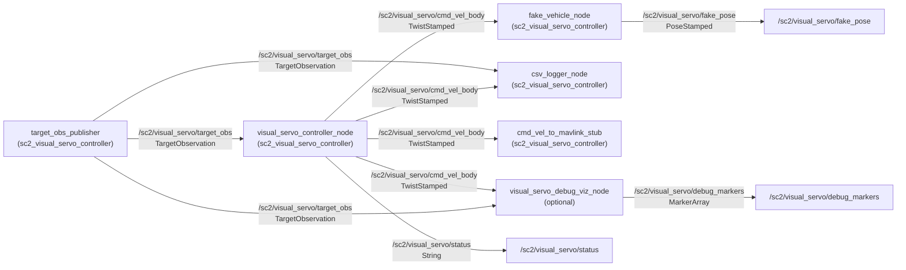
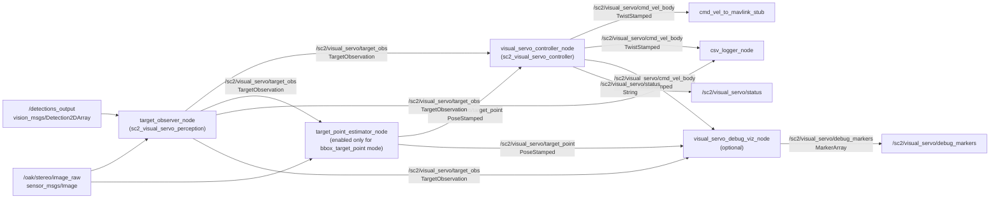

# SeaClear2 Smart Grapple — Visual Servo MVP (ROS2) Node Graph & I/F Map

Scope: active architecture map for the current ROS 2 MVP pipeline.
Source of truth: use this file for node/topic/interface relationships across launch modes.
Last updated: 2026-03-13
Supersedes: older ad hoc node-flow descriptions in status memos.

> Purpose: make it **one-glance obvious** how the MVP pipeline is wired end-to-end (sensor/detection → controller → command),
> and what to replace when moving from **stub sim** → **live perception** → **BlueROV**.

## 1) Launch modes (entry points)
Launch files:
- `src/sc2_visual_servo_bringup/launch/mvp_sim.launch.py`
- `src/sc2_visual_servo_bringup/launch/blue_rov_synth_vs.launch.py`

- **Mode A (default): stub target → controller → cmd**
  - `use_stub_target:=true` (default)
- **Mode B: YOLO+Depth input → controller → cmd**
  - `use_stub_target:=false`
- **Controller mode**
  - `controller_mode:=ibvs` (default), `bbox_approach`, `bbox_target_point`, or `mppi`
- **BlueROV synthetic actuation check (detector-free)**
  - `ros2 launch sc2_visual_servo_bringup blue_rov_synth_vs.launch.py`
  - defaults: `controller_mode:=bbox_approach`, `mavros_backend:=rc_override`

## 2) Controller mode summary

| `controller_mode` | Required inputs | Main control law | Fallback behavior | Typical use |
|---|---|---|---|---|
| `ibvs` | `TargetObservation` | Image-based proportional servo using bbox center error and depth or bbox area proxy | None beyond global target timeout -> zero command | Default MVP mode; simplest end-to-end validation |
| `bbox_approach` | `TargetObservation` | Keep bbox centered with `vy/vz/yaw`; use depth or bbox area proxy for `vx` approach | Global target timeout -> zero command | Detector-only approach tests and BlueROV synthetic validation |
| `bbox_target_point` | `TargetObservation` and, when enabled, `/sc2/visual_servo/target_point` from `target_point_estimator_node` | Keep bbox centered with `vy/vz/yaw`; use ROI-derived target-point distance for `vx` | If target point is stale or missing: either stop (`require_target_point:=true`) or fall back to bbox-only approach | Visual-servo approach with bbox ROI depth representative point |
| `mppi` | `TargetObservation` with finite `depth_m` and MPPI runtime dependencies | MPPI/PBVS-style optimization from reconstructed relative target position | If MPPI runtime is unavailable or depth is not finite, controller falls back to `ibvs` | Phase-2 controller experiments |

Notes:
- `bbox_target_point` is the current name for the old `bbox_grasp` mode. `bbox_grasp` is still accepted as a deprecated alias in code.
- `target_point_estimator_node` does not estimate the final smart-grapple grasp pose from D5.2 Section 5.4. It estimates a camera-frame representative target point for approach control.

## 3) Node graph (topics and message types)

### 2.1 Default (stub) mode


### 2.2 Perception-input mode (YOLO+Depth)


### 2.3 BlueROV synthetic mode (detector-free)
```mermaid
flowchart LR
  S["synthetic_bbox_publisher_node<br/>(sc2_visual_servo_synth)"] -->|/detections_output<br/>Detection2DArray| P["target_observer_node<br/>(optional when direct=false)"]
  S -->|/sc2/visual_servo/target_obs<br/>TargetObservation (direct mode)| B["visual_servo_controller_node<br/>(bbox_approach)"]
  P -->|/sc2/visual_servo/target_obs<br/>TargetObservation| B
  B -->|/sc2/visual_servo/cmd_vel_body<br/>TwistStamped| M["cmd_vel_to_mavros_bridge<br/>(dry_run / rc_override / setpoint_velocity)"]
  B -->|/sc2/visual_servo/status<br/>String| F["/sc2/visual_servo/status"]
  B -->|/sc2/visual_servo/cmd_vel_body<br/>TwistStamped| D["csv_logger_node"]
  S -->|/sc2/visual_servo/target_obs or /detections_output| V["visual_servo_debug_viz_node<br/>(optional)"]
  B -->|/sc2/visual_servo/cmd_vel_body<br/>TwistStamped| V
  V -->|/sc2/visual_servo/debug_markers<br/>MarkerArray| G["/sc2/visual_servo/debug_markers"]
```

## 4) Data contracts (what flows between nodes)

### 3.1 `/sc2/visual_servo/target_obs` — `TargetObservation`
Message: `sc2_visual_servo_interfaces/msg/TargetObservation.msg`

| Field | Meaning (MVP) |
|---|---|
| `header.stamp` | detection timestamp |
| `header.frame_id` | camera optical frame id (e.g., `oak_rgb_camera_optical_frame`) |
| `track_id` | tracker id if available, else -1 |
| `u,v` | bbox center pixel |
| `w,h` | bbox size in pixels |
| `depth_m` | robust depth estimate inside bbox ROI (median). NaN allowed. |
| `confidence` | detection confidence |
| `keypoints_uv` | reserved (future) |
| `source` | provenance string (e.g., `sim_scripted`, `yolo_detection2d`) |

### 3.2 `/sc2/visual_servo/cmd_vel_body` — `geometry_msgs/TwistStamped`
- `header.frame_id` = body frame (default parameter `base_link`)
- `twist.linear.{x,y,z}` = body-frame linear velocity command
- `twist.angular.z` = yaw rate

### 3.3 `/sc2/visual_servo/status` — `std_msgs/String`
- `NO_TARGET_TIMEOUT` when target is missing beyond timeout
- `TRACKING_IBVS`, `TRACKING_BBOX_APPROACH`, `TRACKING_BBOX_TARGET_POINT`, `TRACKING_BBOX_TARGET_POINT_FALLBACK`, or `TRACKING_MPPI`
- `NO_TARGET_POINT_TIMEOUT` when `bbox_target_point` requires a fresh target point and none is available

### 3.4 `/sc2/visual_servo/target_point` — `geometry_msgs/PoseStamped`
- Published only when `enable_target_point_estimator:=true`
- Camera-frame representative target point derived from bbox ROI depth statistics
- This is a visual-servo target point, not the final smart-grapple grasp pose from D5.2 Section 5.4

### 3.5 `/sc2/visual_servo/debug_markers` — `visualization_msgs/MarkerArray`
- Published when `enable_debug_viz:=true`
- Contains bbox panel marker, command vector marker, and optional target-point marker

## 5) What to replace when moving toward hardware

### 4.1 Replace stub target with real perception
**Current**: `target_obs_publisher` produces scripted TargetObservation.

**Replace with**:
- `target_observer_node` (already implemented)
- `target_point_estimator_node` (enabled only when `controller_mode:=bbox_target_point` needs ROI-derived target depth)
- Provide correct topic names:
  - detections: `/detections_output` (or remap)
  - depth: `/oak/stereo/image_raw` (or remap)

### 4.2 BlueROV bridge status
**Available now**:
- `cmd_vel_to_mavros_bridge` supports:
  - `backend:=dry_run` (log only)
  - `backend:=rc_override` (publish to `/mavros/rc/override`)
  - `backend:=setpoint_velocity` (publish to `/mavros/setpoint_velocity/cmd_vel_unstamped`)
- deadman + timeout + command saturation are implemented.

**Still pending**:
- closed-loop validation with vehicle state feedback/pose integration.

### 4.3 Replace placeholder IBVS with MPPI (same I/F)
**Switch** using launch arg:
- `controller_mode:=mppi`

Note: MPPI requires `torch` and a finite depth estimate at runtime; otherwise the controller falls back to `ibvs`. The current default MPPI config does not enable risk/FOV penalty terms.

## 6) Verification protocol (what you must run to claim “works”)

### 5.1 Build + run (MVP stub)
1) `source /opt/ros/humble/setup.bash`
2) `./scripts/uv_bootstrap.sh`
3) `./scripts/colcon_build_venv.sh --packages-up-to sc2_visual_servo_bringup sc2_visual_servo_controller sc2_visual_servo_perception sc2_visual_servo_interfaces sc2_visual_servo_synth`
4) `source install/setup.bash`
5) `ros2 launch sc2_visual_servo_bringup mvp_sim.launch.py`
6) Confirm topic publishing:
- `ros2 topic echo /sc2/visual_servo/cmd_vel_body --once`
- check `/tmp/sc2_visual_servo_mvp.csv` is created and growing

### 5.2 Perception-input run (YOLO+Depth)
1) run your YOLO/depth pipeline
2) `ros2 launch sc2_visual_servo_bringup mvp_sim.launch.py use_stub_target:=false`
3) Confirm:
- `/detections_output` exists and messages arrive
- depth topic is truly a depth image (not rectified left)

### 5.3 Tests (required to claim PR is clean)
- Run:
  - `./scripts/colcon_test_venv.sh --packages-select sc2_visual_servo_perception sc2_visual_servo_controller sc2_visual_servo_bringup`
- Current forced pytest subset covers controller sign checks plus `target_observer` and `target_point_estimator` integration tests.

## 7) Known MVP caveats (intentional)
- No SLAM dependency (by design).
- Default observer depth is bbox-ROI median; target-point estimation adds UV-median-neighborhood depth and optional mask gating.
- BlueROV path is currently open-loop command validation via MAVROS bridge; closed-loop vehicle-state validation is not integrated yet.
