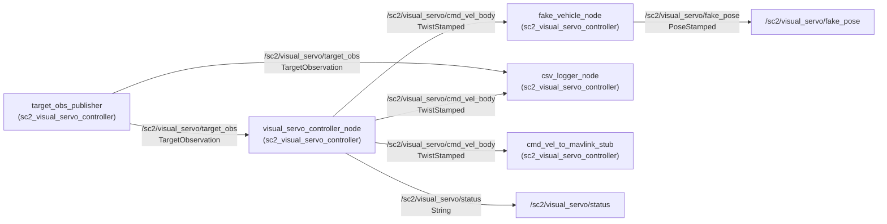
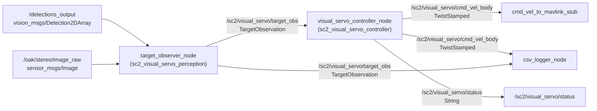

# SeaClear2 Smart Grapple — Visual Servo MVP (ROS2) Node Graph & I/F Map

> Purpose: make it **one-glance obvious** how the MVP pipeline is wired end-to-end (sensor/detection → controller → command),
> and what to replace when moving from **stub sim** → **live perception** → **BlueROV**.

## 1) Launch modes (single entry point)
Launch file: `src/sc2_visual_servo_bringup/launch/mvp_sim.launch.py`

- **Mode A (default): stub target → controller → cmd**
  - `use_stub_target:=true` (default)
- **Mode B: YOLO+Depth input → controller → cmd**
  - `use_stub_target:=false`
- **Controller mode**
  - `controller_mode:=ibvs` (default) or `controller_mode:=mppi`

## 2) Node graph (topics and message types)

### 2.1 Default (stub) mode

### 2.2 Perception-input mode (YOLO+Depth)

## 3) Data contracts (what flows between nodes)

### 3.1 `/sc2/visual_servo/target_obs` — `TargetObservation`
Message: `sc2_visual_servo_interfaces/msg/TargetObservation.msg`

| Field | Meaning (MVP) |
|---|---|
| `header.stamp` | detection timestamp |
| `header.frame_id` | camera optical frame id (e.g., `oak_rgb_camera_optical_frame`) |
| `track_id` | tracker id if available, else -1 |
| `u,v` | bbox center pixel |
| `w,h` | bbox size in pixels |
| `depth_m` | robust depth estimate inside bbox ROI (median). NaN allowed. |
| `confidence` | detection confidence |
| `keypoints_uv` | reserved (future) |
| `source` | provenance string (e.g., `sim_scripted`, `yolo_detection2d`) |

### 3.2 `/sc2/visual_servo/cmd_vel_body` — `geometry_msgs/TwistStamped`
- `header.frame_id` = body frame (default parameter `base_link`)
- `twist.linear.{x,y,z}` = body-frame linear velocity command
- `twist.angular.z` = yaw rate

### 3.3 `/sc2/visual_servo/status` — `std_msgs/String`
- `NO_TARGET_TIMEOUT` when target is missing beyond timeout
- `TRACKING_IBVS` or `TRACKING_MPPI`

## 4) What to replace when moving toward hardware

### 4.1 Replace stub target with real perception
**Current**: `target_obs_publisher` produces scripted TargetObservation.

**Replace with**:
- `target_observer_node` (already implemented)
- Provide correct topic names:
  - detections: `/detections_output` (or remap)
  - depth: `/oak/stereo/image_raw` (or remap)

### 4.2 Replace fake vehicle + MAVLink stub with real BlueROV bridge
**Current**:
- `fake_vehicle_node` integrates cmd to a fake pose
- `cmd_vel_to_mavlink_stub` only logs

**Replace with**:
- `cmd_vel_to_mavros` (new) OR `cmd_vel_to_bluerov_bridge` (new)
  - consumes `/sc2/visual_servo/cmd_vel_body`
  - outputs to your chosen stack (MAVROS2 or direct BlueRobotics)
- keep `csv_logger_node` (useful for debugging)

### 4.3 Replace placeholder IBVS with MPPI (same I/F)
**Switch** using launch arg:
- `controller_mode:=mppi`

Note: MPPI requires `torch` at runtime; if unavailable, it falls back to `ibvs`.

## 5) Verification protocol (what you must run to claim “works”)

### 5.1 Build + run (MVP stub)
1) `source /opt/ros/humble/setup.bash`
2) `./scripts/uv_bootstrap.sh`
3) `./scripts/colcon_build_venv.sh --packages-up-to sc2_visual_servo_bringup sc2_visual_servo_controller sc2_visual_servo_perception sc2_visual_servo_interfaces`
4) `source install/setup.bash`
5) `ros2 launch sc2_visual_servo_bringup mvp_sim.launch.py`
6) Confirm topic publishing:
- `ros2 topic echo /sc2/visual_servo/cmd_vel_body --once`
- check `/tmp/sc2_visual_servo_mvp.csv` is created and growing

### 5.2 Perception-input run (YOLO+Depth)
1) run your YOLO/depth pipeline
2) `ros2 launch sc2_visual_servo_bringup mvp_sim.launch.py use_stub_target:=false`
3) Confirm:
- `/detections_output` exists and messages arrive
- depth topic is truly a depth image (not rectified left)

### 5.3 Tests (required to claim PR is clean)
- Run:
  - `./scripts/colcon_test_venv.sh --packages-select sc2_visual_servo_perception sc2_visual_servo_controller sc2_visual_servo_bringup`

## 6) Known MVP caveats (intentional)
- No SLAM dependency (by design).
- Depth is bbox-ROI median (no mask yet).
- No full BlueROV actuation path yet (stub only).
