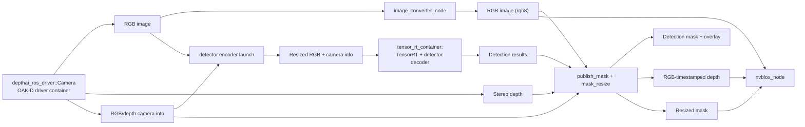
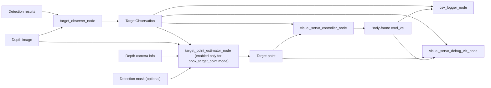

# Visual Servo System Integration Plan (2026-03-13)

Scope: investigation and integration design for unifying the current `oakd_nvblox.launch.py` perception stack with the SC2 visual-servo MVP stack.
Source of truth: use this file when planning the new `oakd_system.launch.py`.
Last updated: 2026-03-13
Supersedes: ad hoc discussion about how `oakd_nvblox.launch.py` and `mvp_sim.launch.py` should be merged.

## 1) Goal and boundary

Goal:
- Introduce a new top-level launch file `oakd_system.launch.py`.
- Reuse the existing OAK-D + detector + mask + nvblox pipeline as the real perception input for visual servoing.
- Keep existing launch files intact for rollback and isolated debugging.

Boundary:
- Do not integrate Visual SLAM, PBVS, or switching logic in this phase.
- Do not delete or rewrite `oakd_nvblox.launch.py`, `mvp_sim.launch.py`, or `blue_rov_synth_vs.launch.py`.

## 2) Current entry points

Current perception/mapping entry point:
- `ros2 launch oakd_isaac_ros oakd_nvblox.launch.py`
- Source: `src/oakd_isaac_ros/launch/oakd_nvblox.launch.py`

Current visual-servo MVP entry point:
- `ros2 launch sc2_visual_servo_bringup mvp_sim.launch.py`
- Source: `src/sc2_visual_servo_bringup/launch/mvp_sim.launch.py`

Current BlueROV synthetic actuation entry point:
- `ros2 launch sc2_visual_servo_bringup blue_rov_synth_vs.launch.py`
- Source: `src/sc2_visual_servo_bringup/launch/blue_rov_synth_vs.launch.py`

Rollback policy:
- The new `oakd_system.launch.py` should be additive.
- Existing launch files remain unchanged and continue to serve as isolated debug paths.

## 3) README entry status

`README.md` already mentions the visual-servo MVP, but only near the end:
- `README.md:280`

Current issue:
- Visual servoing is discoverable, but it is not yet a first-class top-level workflow in the repository narrative.
- This is acceptable for now because README restructuring is explicitly deferred until integration is finished.

## 4) Current `oakd_nvblox.launch.py` graph

### 4.1 Simplified node/topic diagram



### 4.2 Node inventory

Nodes launched directly or via include:
- OAK-D camera driver container from `launch/tools/camera.launch.py`
- `image_converter_node`
- detector encoder include
- `tensor_rt_container`
  - `tensor_rt`
  - detector decoder node
  - `mask_resize_node`
  - `depth_mask_publisher` (`publish_mask`)
- `nvblox_node`
- static TF publishers:
  - `map -> odom`
  - `odom -> oak-d-base-frame`
  - `oak-d-base-frame -> oak_rgb_camera_optical_frame`
- optional Foxglove bridge include
- optional rosbag play action

### 4.3 Topic legend for the diagram

| Diagram label | Actual topic(s) | Message type |
|---|---|---|
| `RGB image` | `/oak/rgb/image_raw` | `sensor_msgs/msg/Image` |
| `Stereo depth` | `/oak/stereo/image_raw_depth` | `sensor_msgs/msg/Image` |
| `RGB image (rgb8)` | `/oak/rgb/image_raw_rgb8` | `sensor_msgs/msg/Image` |
| `Resized RGB + camera info` | Detector encoder resize image and camera-info topics from the current detection launch | `sensor_msgs/msg/Image`, `sensor_msgs/msg/CameraInfo` |
| `Detection results` | `/detections_output` | `vision_msgs/msg/Detection2DArray` |
| `Detection mask + overlay` | `/camera0/detection/mask`, `/camera0/detection/mask/camera_info`, `/mask_overlay` | `sensor_msgs/msg/Image`, `sensor_msgs/msg/CameraInfo`, `sensor_msgs/msg/Image` |
| `RGB-timestamped depth` | `/oak/stereo/image_raw`, `/oak/stereo/camera_info` | `sensor_msgs/msg/Image`, `sensor_msgs/msg/CameraInfo` |
| `Resized mask` | `/camera0/detection/mask_resized`, `/camera0/detection/mask_resized/camera_info` | `sensor_msgs/msg/Image`, `sensor_msgs/msg/CameraInfo` |

## 5) Current visual-servo MVP graph

### 5.1 Simplified node/topic diagram



### 5.2 Topic legend for the diagram

| Diagram label | Actual topic(s) | Message type |
|---|---|---|
| `Detection results` | `/detections_output` | `vision_msgs/msg/Detection2DArray` |
| `Depth image` | `/oak/stereo/image_raw` | `sensor_msgs/msg/Image` |
| `Depth camera info` | `/oak/stereo/camera_info` | `sensor_msgs/msg/CameraInfo` |
| `Detection mask (optional)` | `mask_topic` parameter, candidate `/camera0/detection/mask` | `sensor_msgs/msg/Image` |
| `TargetObservation` | `/sc2/visual_servo/target_obs` | `sc2_visual_servo_interfaces/msg/TargetObservation` |
| `Target point` | `/sc2/visual_servo/target_point` | `geometry_msgs/msg/PoseStamped` |
| `Body-frame cmd_vel` | `/sc2/visual_servo/cmd_vel_body` | `geometry_msgs/msg/TwistStamped` |

### 5.3 Which nodes are placeholders and which are reusable

Real-pipeline reusable nodes:
- `target_observer_node`
- `target_point_estimator_node`
- `visual_servo_controller_node`
- `csv_logger_node`
- `visual_servo_debug_viz_node`

Development-only placeholder nodes:
- `target_obs_publisher`
- `synthetic_bbox_publisher_node`
- `fake_vehicle_node`
- `cmd_vel_to_mavlink_stub`

Integration rule:
- The new `oakd_system.launch.py` must not use the placeholder nodes above.
- The placeholder nodes remain available in the existing debug launches only.

## 6) Topic/interface mapping between the two stacks

### 6.1 Direct producer-to-consumer mapping

| Producer node / launch side | Output topic | Type | Consumer node / launch side | Integration decision |
|---|---|---|---|---|
| detector decoder in `tensor_rt_container` | `/detections_output` | `vision_msgs/msg/Detection2DArray` | `target_observer_node` | Reuse as-is |
| `publish_mask` | `/oak/stereo/image_raw` | `sensor_msgs/msg/Image` | `target_observer_node`, `target_point_estimator_node` | Reuse as-is |
| `publish_mask` | `/oak/stereo/camera_info` | `sensor_msgs/msg/CameraInfo` | `target_point_estimator_node` | Reuse as-is |
| `publish_mask` | `/camera0/detection/mask` | `sensor_msgs/msg/Image` | `target_point_estimator_node` with `use_mask_gating:=true` | Reuse by parameter |
| `target_observer_node` | `/sc2/visual_servo/target_obs` | `TargetObservation` | `visual_servo_controller_node`, `csv_logger_node`, `visual_servo_debug_viz_node`, `target_point_estimator_node` | Keep contract unchanged |
| `target_point_estimator_node` | `/sc2/visual_servo/target_point` | `geometry_msgs/msg/PoseStamped` | `visual_servo_controller_node`, `visual_servo_debug_viz_node` | Keep contract unchanged |
| `visual_servo_controller_node` | `/sc2/visual_servo/cmd_vel_body` | `geometry_msgs/msg/TwistStamped` | `csv_logger_node`, `visual_servo_debug_viz_node`, MAVROS bridge in future integrated launch | Keep contract unchanged |

### 6.2 What "use existing perception topics" means

It means:
- do not invent a second detector output topic for visual servoing,
- do not add an extra depth-preparation node if `/oak/stereo/image_raw` already carries the synchronized depth image,
- use the current detector/depth/mask topics directly as input parameters to the visual-servo nodes.

It does not mean:
- renaming all existing perception topics,
- changing the internal visual-servo interface `/sc2/visual_servo/*`,
- deleting the existing synthetic/debug launch files.

## 7) Comparison against `docs/SC2`

Relevant requirement path from `docs/SC2/vision_pipeline.tex`:
- RGBD input
- detector bounding boxes
- bbox-derived depth masking
- TSDF / dynamic layer generation
- final grasp-point estimation from the detected object region
- visual servoing using camera-relative object information

Current repo status against that chain:
- RGBD input: implemented in `oakd_nvblox.launch.py`
- detector outputs: implemented in `detection.launch.py`
- bbox-derived mask: implemented via `publish_mask.cpp`
- TSDF / dynamic layer: implemented in `nvblox.launch.py`
- final grasp-point estimation:
  - D5.2-style full dynamic-layer grasp estimation is not yet integrated
  - current MVP visual-servo substitute is `bbox_depth_roi` in `target_point_estimator_node`
  - this substitute should be treated as a pre-grasp target-point estimator, not as the final grasp-pose estimator from D5.2 Section 5.4
- visual servo controller:
  - implemented in the SC2 visual-servo packages
  - not yet wired into the `oakd_isaac_ros` real perception launch

Conclusion:
- Perception and controller pieces already exist in the repo.
- The missing step is launch-level integration and a clear top-level workflow.

## 8) `oakd_system.launch.py` design and current implementation

### 8.1 Design principles

- Additive only:
  - do not modify existing launch entry points beyond what is necessary for reuse.
- Real pipeline by default:
  - no synthetic or stub nodes in this launch.
- Visual servo internal interfaces remain stable:
  - `/sc2/visual_servo/target_obs`
  - `/sc2/visual_servo/target_point`
  - `/sc2/visual_servo/cmd_vel_body`
- Optional subsystems are controlled by launch arguments rather than separate ad hoc launch files.

### 8.2 Implemented node set

Always-on core:
- camera include: `launch/tools/camera.launch.py`
- `image_converter_node`
- detection include: `launch/tools/detection.launch.py`
- `target_observer_node`
- `visual_servo_controller_node`
- `csv_logger_node`
- `visual_servo_debug_viz_node`

Optional:
- `target_point_estimator_node`
- `launch/tools/nvblox.launch.py`
- MAVROS bridge node
- Foxglove bridge include

### 8.3 Implemented launch arguments

Perception side:
- `run_oakd`
- `enable_detection`
- `enable_nvblox`

Visual-servo side:
- `enable_visual_servo`
- `controller_mode`
- `target_class`
- `min_confidence`
- `use_depth`
- `enable_target_point_estimator`
- `use_mask_gating`
- `mask_topic`
- `enable_mavros_bridge`
- `mavros_backend`

Visualization/logging:
- `enable_debug_viz`
- `csv_path`
- `enable_visualization`

### 8.4 First integration target

The first integrated real-pipeline target should be:

```text
OAK-D camera -> detector outputs -> target_observer_node -> visual_servo_controller_node -> cmd output
```

Optional second step in the same launch:

```text
... + target_point_estimator_node -> bbox_target_point controller mode
```

Optional third step:

```text
... + nvblox_node
```

Rationale:
- visual servo does not require nvblox to work,
- nvblox is useful for keeping parity with the D5.2 perception pipeline,
- the controller should not be blocked on TSDF availability.

## 9) Current implementation status

Implemented:
1. `src/oakd_isaac_ros/launch/oakd_system.launch.py` exists.
2. It reuses the current perception producers unchanged:
   - `/detections_output`
   - `/oak/stereo/image_raw`
   - `/oak/stereo/camera_info`
   - optional `/camera0/detection/mask`
3. It instantiates the SC2 visual-servo nodes inside the new launch.
4. `enable_nvblox:=false` is supported for controller bring-up without TSDF.

Still pending:
1. Colcon build and runtime verification in a ROS 2 Humble environment.
2. Promote `oakd_system.launch.py` as the primary README workflow after runtime validation.

## 10) Non-goals for this phase

- No Visual SLAM launch integration.
- No PBVS or IBVS/PBVS switching integration.
- No removal of old launch files.
- No forced topic renaming across the existing perception stack.
